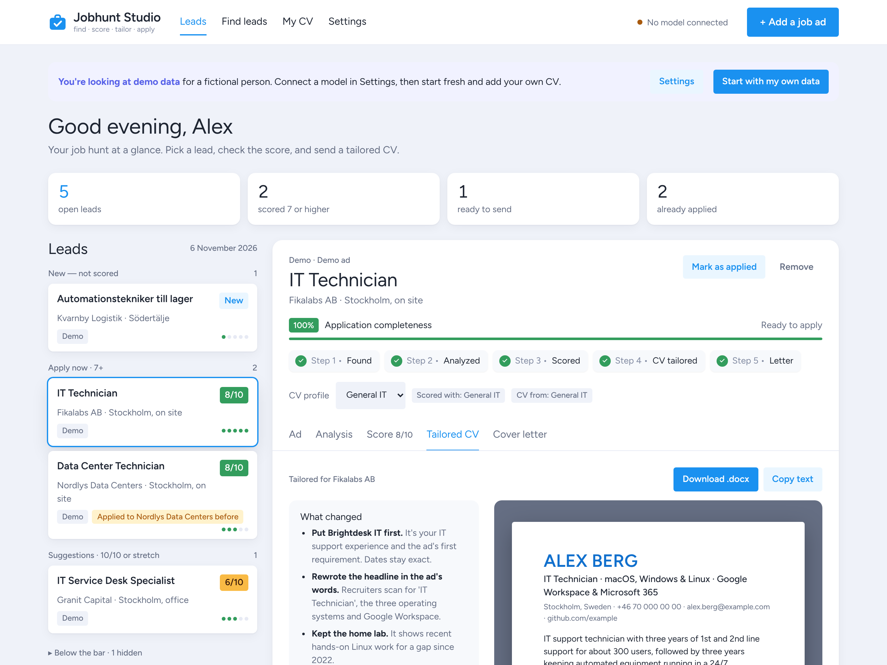

# Jobhunt Studio

**Score job ads against your CV, then tailor an honest CV and cover letter — with Claude or any LLM, right in your browser.**



Paste a job ad and Jobhunt Studio takes it through five steps:

1. **Found** — the ad is saved as a lead.
2. **Analyzed** — must-haves, nice-to-haves, deadlines, tests and shifts are pulled out.
3. **Scored** — every requirement is checked against your CV (met / partial / gap, with evidence) and the job gets a 0–10 score. 7+ goes to *Apply now*, 10/10 or a near-miss goes to *Suggestions*, the rest is hidden.
4. **CV tailored** — your CV is rewritten for that ad, with a list of what changed and why, plus the requirements it deliberately did **not** claim.
5. **Letter** — it decides whether a cover letter is required, recommended or optional, then writes one in the ad's language.

Download either as a Word file or copy the text.

### What makes it different

- **It doesn't invent things.** A *Facts and limits* list (real dates, skill levels, "never claim") overrides your CV in every step. Gaps are shown, not hidden.
- **Quality over volume.** There is no auto-apply. It helps you send fewer, better applications.
- **Any model.** Anthropic (Claude), OpenAI, OpenRouter, a local model through Ollama, or any OpenAI-compatible API. You bring your own key.
- **No server, no account.** It's a static web page. Your CV, leads and key stay in your browser.
- **Works with an agent.** An optional workflow (`workflow/`) lets Claude Code or another agent search job boards daily, write a report and hand you an importable leads file.
- **Nordic-friendly.** Swedish job boards (Platsbanken, thehub.io) are built in, and Swedish ads get Swedish CVs and letters.

> **Project status:** provided as-is and **not actively maintained**. It works, it's small, and it has no dependencies to update. Issues and pull requests may not get answers; forks are very welcome.

---

## Quick start

### Use it online

If the repository owner has GitHub Pages turned on, the app is at `https://<owner>.github.io/jobhunt-studio/`. Open it, go to **Settings**, add your model and key, then **Start with my own data**.

### Run it on your computer

You need either Node.js 18+ or Python 3.

```bash
git clone https://github.com/noahirkz/jobhunt-studio.git
cd jobhunt-studio
npm start                 # or: python3 -m http.server 8080
```

Open <http://localhost:8080>. (Opening `index.html` directly from disk won't work: browsers block JavaScript modules from `file://`.)

### First run

1. **Settings** → pick a provider, paste your API key, press **Test connection**.
2. Press **Start with my own data** (this clears the fictional demo person).
3. **My CV** → paste or upload your CV (.docx or .txt). Fill in **Facts and limits**.
4. **+ Add a job ad** → paste the full ad → **Analyze & score** → **Tailor CV** → **Write cover letter**.

---

## Choosing a model

| Provider | API address (default) | Key | Notes |
|---|---|---|---|
| Anthropic (Claude) | `https://api.anthropic.com` | [console.anthropic.com](https://console.anthropic.com) | Default model `claude-sonnet-5-5`. Works straight from the browser. |
| OpenAI | `https://api.openai.com/v1` | [platform.openai.com](https://platform.openai.com) | Enter a model name from your account. |
| OpenRouter | `https://openrouter.ai/api/v1` | [openrouter.ai](https://openrouter.ai) | One key for many models; names look like `provider/model`. |
| Ollama (local, free) | `http://localhost:11434/v1` | none | See below. |
| Other | your endpoint | optional | Anything that accepts `POST /chat/completions`, e.g. LM Studio. |

Stronger models score more strictly and follow the "never invent" rules better. Small local models work, but check their output carefully.

**Ollama.** Install [Ollama](https://ollama.com), pull a model (`ollama pull llama3.1`), and enter that name in Settings. If you run Jobhunt Studio from `localhost`, it should work as is. If you use the hosted GitHub Pages version, allow that address first:

```bash
OLLAMA_ORIGINS="https://<owner>.github.io" ollama serve
```

**Costs.** You pay your provider directly. One lead (score + CV + letter) is three requests of a few thousand tokens each.

## Privacy and security

- **Where your data lives:** your browser's local storage, on this device only. Nothing is sent anywhere until you press a step button.
- **What gets sent:** when you run a step, the job ad, your active CV profile and your *Facts and limits* go **directly from your browser to the provider you chose**. Read your provider's data policy.
- **Your API key** is stored separately from the rest. By default it's forgotten when you close the tab; tick *Remember the key on this device* to keep it. Backups never include it. Don't save your key on a shared computer.
- **Calling the API from a browser.** Anyone with access to your browser profile can read a remembered key. Use a key with a spending limit.
- **Backups:** browsers can clear site data. Use **Settings → Download backup** now and then.
- The page loads scripts only from itself (strict Content Security Policy), and all text from models and ads is escaped before display.

---

## The agent workflow (optional)

`workflow/` turns any agent that can browse the web — [Claude Code](https://claude.com/claude-code), a scheduled Claude task, or similar — into a daily job scout.

1. Copy `workflow/agent.template.md` to `workflow/agent.md` and fill in the `[[placeholders]]` (your roles, region, facts, search terms). `workflow/agent.md` is git-ignored.
2. Put your CV somewhere private, e.g. `private/cv.md` (also git-ignored).
3. Ask the agent: *"Run the daily job search from workflow/agent.md."* With Claude Code, `CLAUDE.md` in this repo already points it there.
4. It writes `reports/YYYY-MM-DD.md` (see `workflow/examples/report.example.md`) and `reports/YYYY-MM-DD.leads.json`.
5. In the app: **Find leads → Import leads** → choose the `.leads.json` file.

### Word documents from the command line

Two scripts build a CV and a cover letter from YAML (or JSON) without the web app:

```bash
pip install -r workflow/scripts/requirements.txt
python workflow/scripts/build_cv.py workflow/examples/profile.example.yaml
python workflow/scripts/build_cover_letter.py workflow/examples/profile.example.yaml workflow/examples/letter.example.yaml
```

Files go to `output/` (git-ignored). Copy the examples to `workflow/profile.yaml` and `workflow/letter.yaml` for your own data; both are git-ignored. The profile uses the same shape as the app's tailored CV.

---

## Deploy your own copy

It's a static site: any host works.

- **GitHub Pages:** fork the repo → **Settings → Pages → Source: GitHub Actions**. The included workflow (`.github/workflows/pages.yml`) publishes on every push to `main`.
- **Netlify / Vercel / Cloudflare Pages:** no build command; publish directory is the repo root.
- **Anywhere else:** upload `index.html`, `styles.css`, `src/`, `assets/` and `vendor/`.

## Customize

| To change… | Edit |
|---|---|
| Job boards in *Find leads* | `BOARDS` in `src/config.js` |
| Providers and default models | `PROVIDERS` in `src/config.js` |
| Score thresholds (7 / 5 / 10) | `SCORE` in `src/config.js` |
| What the model is asked | `src/prompts.js` (keep the JSON shapes, or update the views too) |
| Look and feel | `styles.css` (colour tokens at the top, light and dark) |
| Demo person and ads | `src/demo.js` (keep it fictional) |

## Project structure

```
index.html            page shell
styles.css            all styles (light + dark)
src/
  main.js             state, events, running the steps
  config.js           providers, job boards, thresholds
  prompts.js          the four prompts + reply checks
  llm.js              calls Anthropic / OpenAI-compatible APIs, parses JSON
  store.js            saved state, backups, imports
  documents.js        plain text and .docx export, .docx import
  util.js             small helpers
  demo.js             fictional demo data
  views/              one file per screen (leads, find, cv, settings)
vendor/jszip/         JSZip 3.10.1 (MIT), for Word files
assets/               icon and Figtree font (SIL OFL)
workflow/             agent instructions, examples, Python document scripts
scripts/              local server, privacy check
tests/                unit tests (node --test)
```

## Development

No install needed.

```bash
npm test                # unit tests
npm run check:privacy   # scan for personal data before you push
npm run check           # both (also runs in CI)
```

**Privacy check.** `scripts/privacy-check.mjs` fails if anything that looks like a real email, phone number, personal identity number, API key or document file (.docx/.pdf/.xlsx) would be published. Add your own words (name, address, past employers) to `.privacy-denylist` (git-ignored; see `.privacy-denylist.example`). Run it before every push if you keep your own data in a fork.

## Credits and licence

MIT — see [LICENSE](LICENSE). Bundled: [JSZip](https://stuk.github.io/jszip/) (MIT or GPLv3, used under MIT) and the [Figtree](https://github.com/erikdkennedy/figtree) font (SIL Open Font License, see `assets/fonts/OFL.txt`).

Jobhunt Studio is a helper, not a recruiter. Read every CV and letter before you send it.
If you want to test the Demo, here the link "https://noahirkz.github.io/JobHunt-studio/." be cautious with the linking your API in the browser. hope it will help like it did for me. JAH BLESS!!
